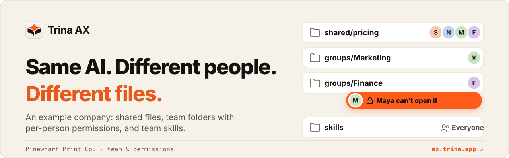
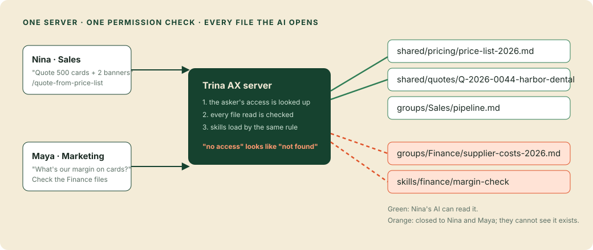
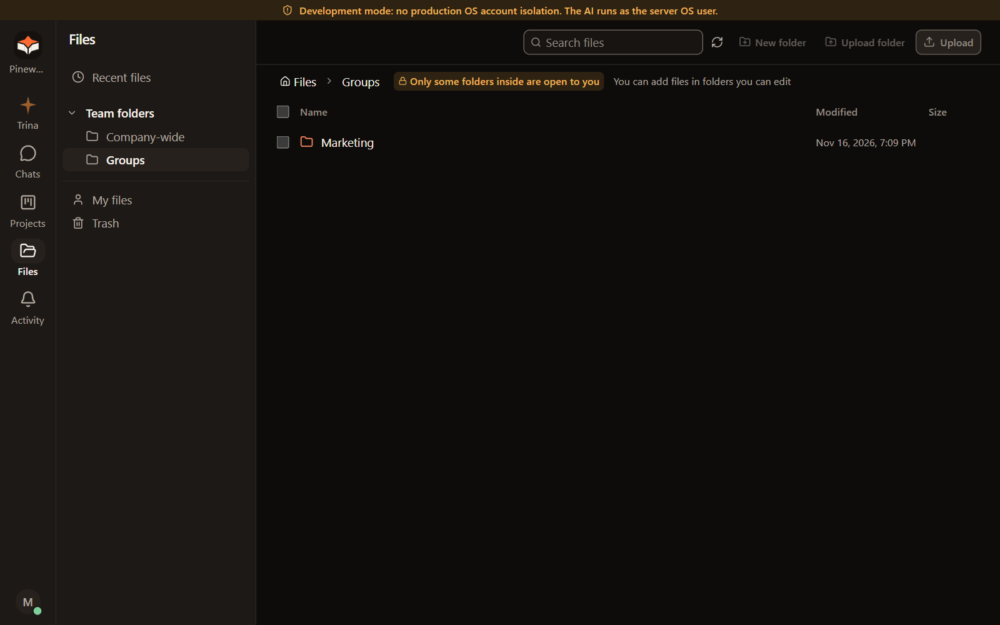
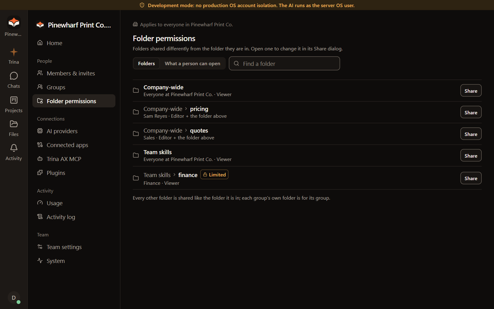
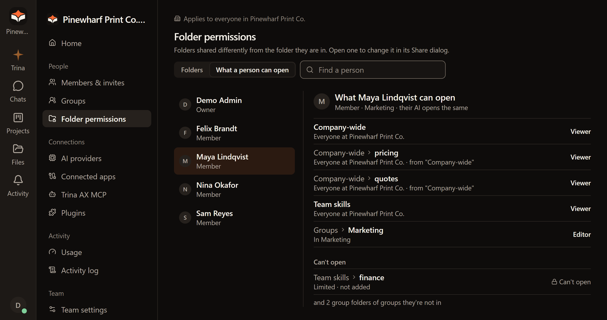
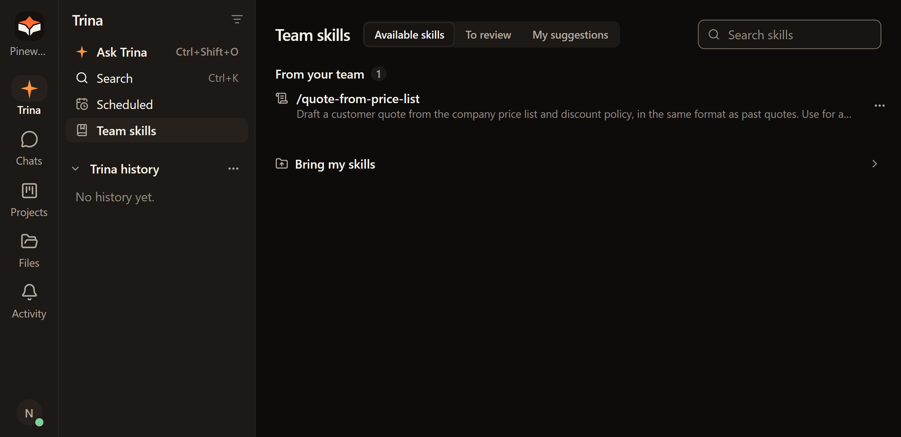
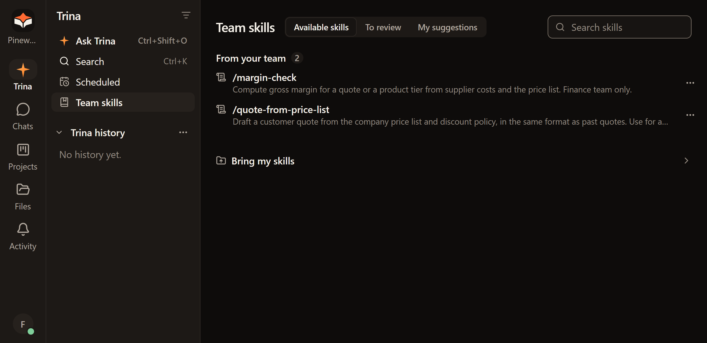
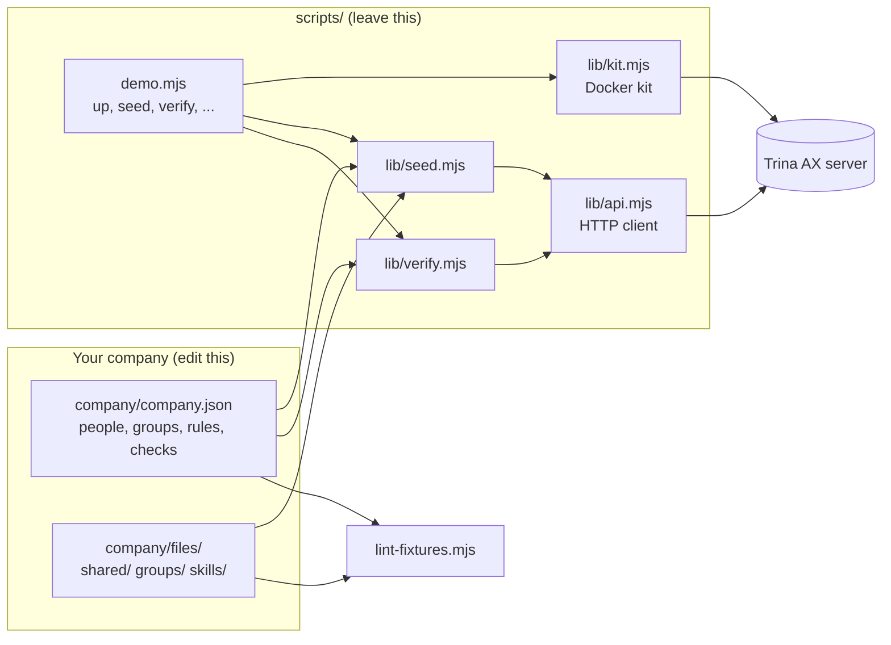

<div align="center">



<br>

**An example company for [Trina AX](https://github.com/trina-app/trina-ax).**<br>
Shared company files, team folders with per-person permissions, and team skills, ready to run and easy to copy.

[](https://github.com/Infrasity-Labs/trina-repo-1/actions/workflows/lint.yml)
[](LICENSE)


[The problem](#the-problem) · [How Trina solves it](#how-trina-solves-it) · [This example](#this-example) · [Run it](#run-it) · [Try it](#try-it) · [Make it your own](#make-it-your-own) · [Contributing](CONTRIBUTING.md)

</div>

## The problem

Two things go wrong when a company starts using AI.

**1. Everyone's AI starts from nothing.** A new hire asks for a quote and their AI has never seen the price list, the discount policy or the quotes the team already sent. The few people who spent months tuning their own setup get good answers. Everyone else gets a question back: *"Who are they?"*

**2. The fix creates a new risk.** Hand the AI the company's files and it can read whatever it can reach, for whoever asks. A marketing intern could ask about margins and get an answer built from the Finance folder.

Teams usually end up choosing between an AI that knows nothing and an AI that knows too much.

## How Trina solves it

[Trina AX](https://github.com/trina-app/trina-ax) puts the company's files, skills and tools on one server. Claude Code and Codex run there for the whole team.

- **Everyone starts from the same place.** Shared files and team skills are in every person's AI by default, so a first-day teammate works from the company's own price list and its way of writing quotes.
- **Every file is checked as the person who asked.** The AI can only open what that person may open. Where they have no access, the folder is not shown at all and a direct request answers like a missing file.
- **Skills follow the same rules.** A team skill is visible and usable only by the people who can read its folder, and a skill never grants extra access.

## This example

This repo is a small company set up that way, so you can see both effects and copy the setup. Pinewharf Print Co. is a print shop with Sales, Marketing and Finance teams.

1. **A new teammate gets a quote from the company price list.** Nina, on her first day, asks for a quote. The `quote-from-price-list` skill makes the AI read the price list, the discount policy and a past quote for the same customer, and write the quote in the company's format.
2. **A marketing user cannot open Finance, and neither can their AI.** Maya's Files view has no Finance folder at all. Asking her AI about margins finds nothing, because the AI can only open what the person asking can open.

<div align="center">

</div>

## The company

**Pinewharf Print Co.** prints business cards, roll-up banners and tote bags. Quotes depend on quantity tiers, so an AI answer is easy to check by hand.

| Sign in as | Who | Group | Can open |
|---|---|---|---|
| `nina` | New teammate, first day | Sales | company files, Sales folder |
| `sam` | Sales lead | Sales | the same, and edits the price list |
| `maya` | Marketing lead | Marketing | company files, Marketing folder |
| `felix` | Finance lead | Finance | company files, Finance folder, Finance skill |
| `pinewharf-admin` | Owner | none | everything |

Members' password: `pinewharf-demo-1` (public, fictional). The owner's password is random and saved in `.demo/owner-password`.

### Who can open what

`R` read, `W` write, `-` not visible (answers exactly like a path that does not exist).

| Path | Nina | Sam | Maya | Felix |
|---|---|---|---|---|
| `shared/handbook/` | R | R | R | R |
| `shared/pricing/` (price list, discount policy) | R | **W** | R | R |
| `shared/quotes/` (past quotes) | **W** | **W** | R | R |
| `groups/Sales/` | W | W | - | - |
| `groups/Marketing/` | - | - | W | - |
| `groups/Finance/` (supplier costs, margins, budget) | - | - | - | W |
| skill `quote-from-price-list` | use | use | use | use |
| skill `margin-check` (`skills/finance/`) | - | - | - | use |

The rules behind this table are in [`company/company.json`](company/company.json). Trina AX's default lets everyone *write* `shared/`; this repo replaces that with read-only, then adds write for Sam on `pricing` and for Sales on `quotes`. `skills/finance` is a *limited* folder readable only by the Finance group.

### Screens

| Maya's Files: Groups | Admin: the rules | Admin: what Maya can open |
|---|---|---|
|  |  |  |

| Nina's Team skills | Felix's Team skills |
|---|---|
|  |  |

Captured from a source-run Trina AX 0.5.9 development server; the orange "Development mode" strip at the top of the window is cropped out.

## Run it

You need [Docker](https://docs.docker.com/get-docker/) on a host the Trina AX Docker kit supports, Node 20+ and git.

> **Check [docs/hosts.md](docs/hosts.md) first.** Trina AX sandboxes every AI turn, which needs a Linux kernel with cgroup v2 and Landlock. Docker Desktop on Windows (WSL2, default kernel) does not meet that: `up` stops with a message saying so. Use a Linux machine or a small cloud VM.

```sh
git clone https://github.com/Infrasity-Labs/trina-repo-1.git
cd trina-repo-1
node scripts/demo.mjs up
```

`up` starts the Trina AX Docker kit (v0.5.9), starts the server, creates the team, seeds the company, and runs `verify`. Then open `http://127.0.0.1:47830` (use `127.0.0.1`, not `localhost`) and sign in as any person above. Files, permissions and skills work now, with no AI account.

The first start builds an image and downloads Trina AX's AI engine (about 300 MB), whether or not you use AI. No timings are claimed yet: none were measured on a supported host.

### Connect your own Claude account (for the AI)

```sh
claude setup-token                              # prints a token; save it to token.txt
node scripts/demo.mjs ai-token < token.txt      # hands it to the server
```

AI usage is billed to the account you connect, and the context a request needs goes to Anthropic. This software setting does not grant permission under Anthropic's terms: use an account and plan authorized for it.

### Other commands

```sh
node scripts/demo.mjs verify         # who can open what, no AI involved
node scripts/demo.mjs status         # container and health
node scripts/demo.mjs down           # stop, keep the data
node scripts/demo.mjs reset --yes    # delete this demo's container, volume and .demo/ (nothing else)
node scripts/lint-fixtures.mjs       # arithmetic and leak checks on the sample files, no server needed
```

The demo runs as its own Docker Compose project (`pinewharf-trina-ax`) on port 47830, so it never touches a Trina AX you already run.

## Try it

1. **Maya can't see Finance.** Sign in as `maya` → Files → Groups. Only Marketing is listed.
2. **The admin view.** Sign in as `pinewharf-admin` → team name (top left) → Admin → Folder permissions → *What a person can open* → Maya.
3. **Change a rule live.** As the owner, share `Groups/Finance` with Maya; Finance appears on her next load. Remove her and it is gone.
4. **Ask for a quote (needs the AI).** Sign in as `nina` and send:

   ```
   /quote-from-price-list Harbor Dental wants 500 double-sided business cards and 2 roll-up banners. Can you quote it?
   ```

   Expected: cards 500 × $0.22 = $110.00, banners 2 × $89.00 = $178.00, subtotal $288.00, no discount, shipping $15.00, total **$303.00**, quote number Q-2026-0048, and a note that Harbor Dental's earlier order was 250 cards at $0.30. It is a draft: a person reads it before it goes out. AI answers vary, so check the sources it shows.
5. **Ask for margins (needs the AI).** As `maya`: `What is our margin on business cards? Check the Finance files if you need to.` As `felix`: the same question.

Step-by-step with screens: [docs/walkthrough.md](docs/walkthrough.md). Recording a demo GIF: [docs/recording.md](docs/recording.md).

## What was tested

- `verify` (48 checks), a second `seed` run (nothing duplicated or changed), and a negative test (granting Maya Finance makes `verify` fail, revoking makes it pass) were run against a real Trina AX 0.5.9 server started from source in development mode.
- The Docker path was run up to the container's installer on Docker Desktop (WSL2), where it stops because that kernel has no cgroup v2 ([docs/hosts.md](docs/hosts.md)). It has **not** been run to a healthy server on a supported host.
- The AI answers (the quote, Maya's margin question) have **not** been run yet. The skills load and are listed for the right people; whether the model reproduces the golden quote is checked by [docs/recording.md](docs/recording.md).

## What this does not show

- Self-hosting is not offline: what a request needs goes to the AI provider you connect.
- Server operators can read stored files and chats. Removing someone's access does not erase answers they already saw.
- Development mode has no OS-level isolation; the Docker kit does. Do not judge the AI lockout in development mode: the AI there runs as your OS user.
- MCP servers, Google Drive, Slack, rooms, scheduled tasks, projects and guests are not part of this example.
- Trina AX's HTTP API is not a stable public API. The scripts pin v0.5.9 (`scripts/lib/config.mjs`) and `verify` fails loudly if the server behaves differently.

## Make it your own

The company is data. `seed.mjs`, `verify.mjs`, `api.mjs` and `kit.mjs` contain no company names, so changing the data seeds a different company. Three spots still carry Pinewharf and need a quick edit: the Compose project name and port in `scripts/lib/config.mjs`, the sample prompt that `up` prints at the end (`scripts/demo.mjs`), and the price and margin checks in `scripts/lint-fixtures.mjs`.

### How it fits together



`up` runs these in order: check Docker, git and Node, fetch the Trina AX kit, start the server and wait for it to be healthy, then create the team and owner. After that it seeds groups, people, folder rules, files, settings and the company profile, and finally runs `verify`.

### Repository layout

```
.
├── company/                     the example company: all of the data
│   ├── company.json             people, groups, folder rules, uploaders, settings, profile, checks
│   └── files/                   seeded at the same paths in the team's folder tree
│       ├── shared/              handbook/, pricing/, quotes/ (readable by everyone)
│       ├── groups/              Sales/, Marketing/, Finance/ (one folder per group)
│       └── skills/              quote-from-price-list/ and finance/margin-check/
├── scripts/
│   ├── demo.mjs                 CLI: up, seed, verify, ai-token, status, logs, down, reset
│   ├── lint-fixtures.mjs        checks quote and margin arithmetic, cost leaks, skill headers
│   └── lib/
│       ├── config.mjs           pinned Trina AX version, project name, port, paths
│       ├── kit.mjs              preflight, Docker kit fetch, compose, health wait
│       ├── api.mjs              the only file that knows Trina AX's HTTP paths
│       ├── seed.mjs             creates groups, people, rules and files from company.json
│       └── verify.mjs           signs in as each person and checks the access matrix
├── docs/
│   ├── hosts.md                 which Docker hosts can run it
│   ├── walkthrough.md           admin screens, changing a rule live
│   ├── recording.md             how to record the demo GIF
│   ├── PRD.md                   the requirements this repo was built from
│   └── media/                   banner, diagram and screenshots
├── .github/                     lint workflow, issue and pull request templates
├── CONTRIBUTING.md  CODE_OF_CONDUCT.md  SECURITY.md  CHANGELOG.md  LICENSE
└── package.json                 script shortcuts, no dependencies
```

### Adapt it to your company

1. **Edit the people and groups** in `company/company.json`. Every person is a member in one group; the owner is separate.
2. **Set the folder rules.** A rule gives a person, a group or everyone read or write on a folder. `limited: true` cuts off what the folders above would grant, which is how `skills/finance` stays Finance-only.
3. **Replace the files** under `company/files/`. Put them at the path where they should live: `shared/` for everyone, `groups/<name>/` for one team, `skills/<name>/SKILL.md` for team skills.
4. **Write the checks.** For each person, list the paths they `opens`, the paths that must be `closed`, the folders that must be `hiddenInTree`, and the `skills` they can use. `verify` fails if the server disagrees.
5. **Update the three Pinewharf spots** listed above, run `node scripts/lint-fixtures.mjs`, then `node scripts/demo.mjs up` on a fresh server.

## Contributing, conduct, security

See [CONTRIBUTING.md](CONTRIBUTING.md), [CODE_OF_CONDUCT.md](CODE_OF_CONDUCT.md) and [SECURITY.md](SECURITY.md). Changes are listed in [CHANGELOG.md](CHANGELOG.md).

## License

[MIT](LICENSE).
