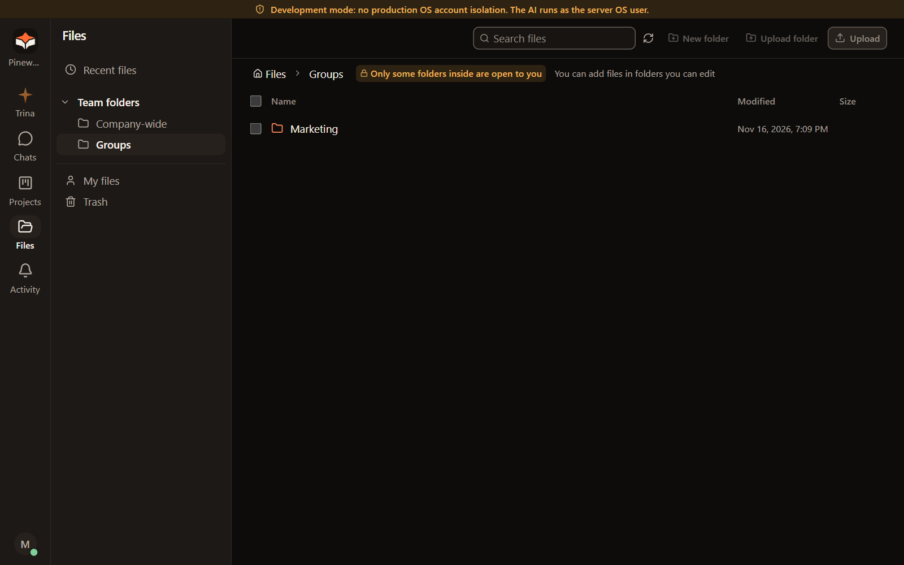
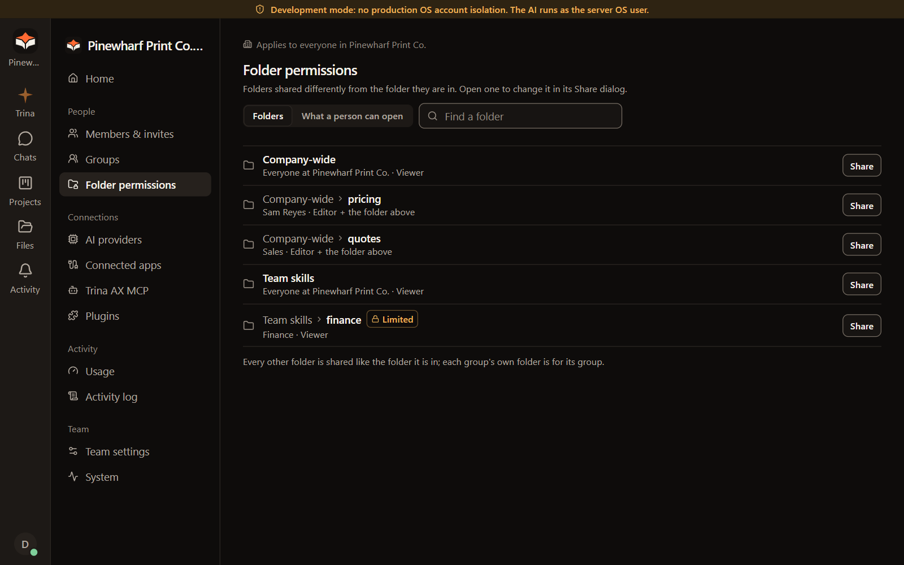
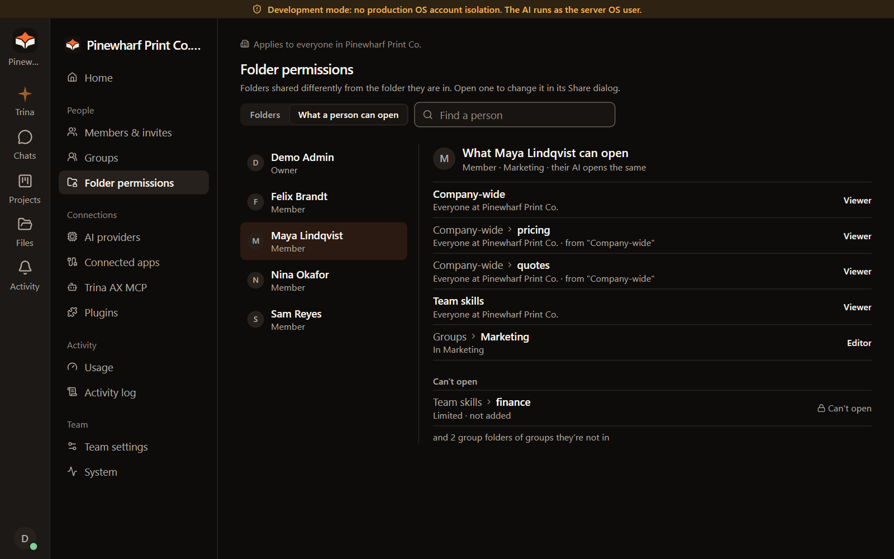

# Walkthrough

The screens and menu paths below were checked on a running Trina AX 0.5.9 server seeded by this repo (a source-run development server, which is why the orange "Development mode" banner shows). Exceptions are marked. The screens are Trina AX's own UI (English). Sign in at `http://127.0.0.1:<port>` with the usernames from the README.

## 1. See what Maya sees (no AI needed)

Sign in as `maya` / `pinewharf-demo-1` → **Files** → **Groups**.

Only **Marketing** is listed. There is no Finance entry, and no "access denied". A direct request for a Finance file answers exactly like a request for a file that does not exist (`verify` checks that). The orange "Only some folders inside are open to you" note is Trina's own hint that the list is filtered.

**Company-wide** (the `shared/` folder) holds the price list, the discount policy, past quotes and the handbook, readable by everyone. Maya's AI opens the same files she does and no others.

## 2. See the same thing from the admin side

Sign in as `pinewharf-admin` (password in `.demo/owner-password`) → click the team name at top left → **Admin** → **Folder permissions**.

These are the four rules in `company/company.json`: everyone reads `Company-wide`; only Sam edits `pricing`; Sales edits `quotes`; `Team skills › finance` is **Limited** to the Finance group. The group folders (`Groups/Sales`, `Groups/Marketing`, `Groups/Finance`) are not listed because each is for its own group by default.

Open the **What a person can open** tab and pick **Maya Lindqvist**:

"Their AI opens the same" is the product's own wording: the AI is limited to the person who asks.

## 3. Change a rule and watch it take effect

As the owner: **Files** → **Groups** → hover **Finance** → **⋯** → **Share** → type `Maya` in "Add people and groups", pick her, set **Viewer**, **Done**. (Checked in the UI up to picking her from the list; the grant itself was checked through the API.)

Maya reloads Files › Groups: **Finance** is there and she can open `supplier-costs-2026.md`. (Checked through the API: the entry appeared on her very next request.) Remove her in the same dialog and it is gone again, with no sign-out needed.

Her AI follows her access (the product's documented behaviour; not tried here), so it can now read them too. She still does **not** get the Finance team skill (`margin-check`): `Team skills › finance` has its own rule, and a skill never grants access by itself.

Run `node scripts/demo.mjs verify` afterwards; it fails while Maya has the extra access and passes again after you remove it.

## 4. The skills

Any member: **Team skills** (left column) lists `/quote-from-price-list`. Felix additionally sees `/margin-check`. Type `/` in the chat box to pick one.

## 5. The AI (needs your own Claude account)

Connect it first (README, step 3). Then:

- As `nina`: `/quote-from-price-list Harbor Dental wants 500 double-sided business cards and 2 roll-up banners. Can you quote it?`
  Expected: cards 500 × $0.22 = $110.00, banners 2 × $89.00 = $178.00, subtotal $288.00, no discount, shipping $15.00, total **$303.00**, quote number Q-2026-0048, and a note that Harbor Dental's last order (Q-2026-0044) was 250 cards at $0.30.
- As `nina`, a limit probe: add "and they want 12% off". Expected: the discount is left out and Sam Reyes is named as the approver.
- As `maya`: `What is our margin on business cards? Check the Finance files if you need to.` Expected: it cannot find or open such data.
- As `felix`: the same question. Expected: margins that match `groups/Finance/margin-report-2026-q3q4.md`.

AI answers vary from run to run. These are the expected results, not a guarantee; read the sources the answer shows.
